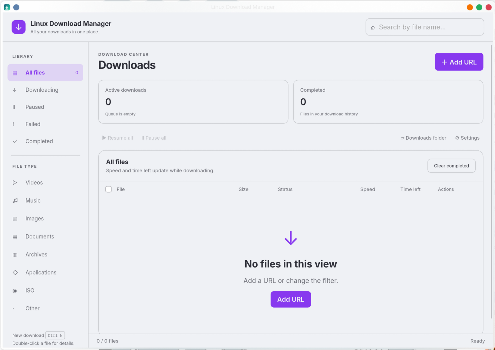
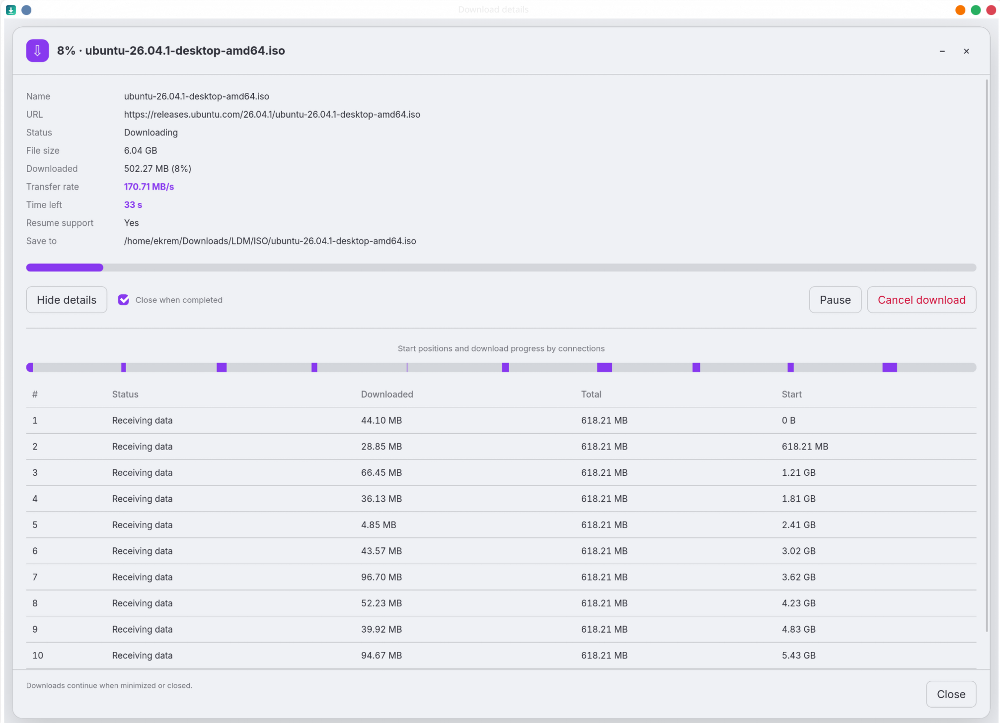
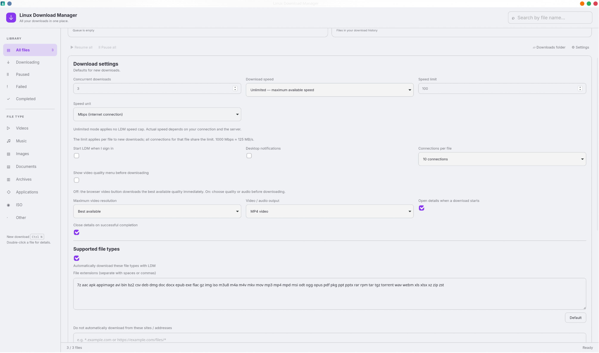
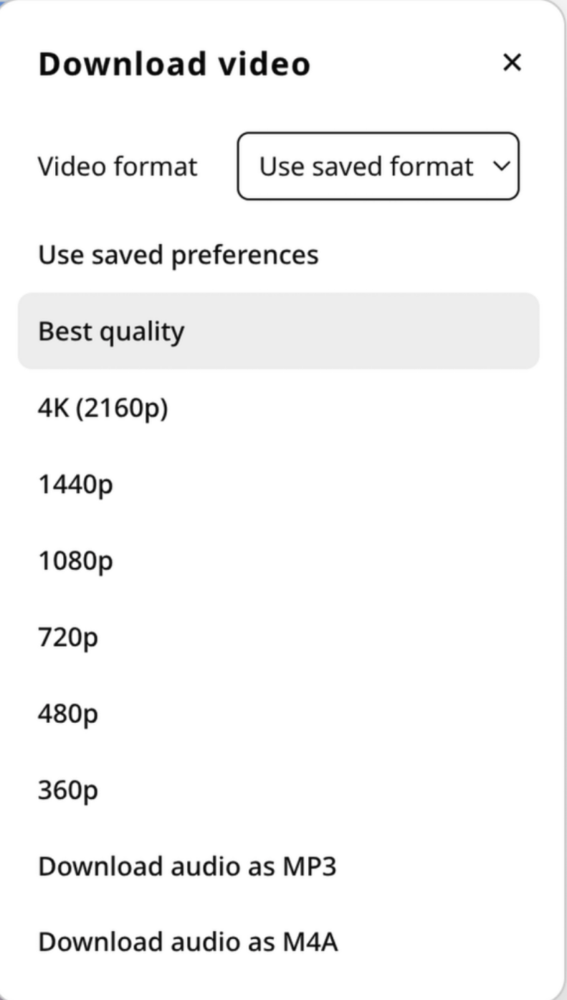

<p align="center">
  
</p>

<h1 align="center">Linux Download Manager</h1>

<p align="center">
  Your files, videos and audio — managed in one place.<br>
  A Linux desktop download manager with browser integration, parallel transfers and system theme colors.
</p>

<p align="center">
  <a href="#installation">Install</a> ·
  <a href="#browser-setup">Browser setup</a> ·
  <a href="#features">Features</a> ·
  <a href="#usage">Usage</a> ·
  <a href="#troubleshooting">Troubleshooting</a>
</p>

## A look inside

### Download library

Search, filter and manage your downloads from a single window. Files are organized into categories, with live speed and remaining-time information during transfers.



### Download details

Inspect individual connections, transferred bytes and overall progress. Pause, resume or cancel a download, and keep it running when the details window is minimized or closed.



*Screenshots show one Linux theme and an example transfer. Colors follow your system theme; transfer speed depends on your connection and the source server.*

### Settings

Choose speed limits, connections per file, startup behavior and video preferences. Enable the optional quality menu, control when download details open, and customize which file types LDM captures from your browser.



## Features

| Feature | What it does |
| --- | --- |
| Parallel downloads | Configurable connections per file, with a default of 10 and server-aware fallback. |
| Browser capture | Send supported file types to LDM; customize extensions and excluded sites. |
| Video downloads | Dedicated controls for YouTube, X/Twitter, Reddit, Instagram and Facebook, plus supported embedded players. |
| Video and audio formats | Save video as MP4, MKV or WebM, or extract real MP3/M4A audio. |
| Saved preferences | Remember resolution, output format, connection count and speed limits. |
| Batch URLs | Paste multiple links and add them to the queue in one operation. |
| Download controls | Pause, resume, retry, cancel, schedule and optionally verify a SHA-256 checksum. |
| Organized library | Category folders, search, sortable columns and selection controls. |
| Desktop integration | System theme colors, tray operation, notifications and optional automatic details windows. |
| Extension popup | View desktop transfers and pause, resume or cancel them from the browser. |

## Installation

### Portable AppImage

Download **Linux_Download_Manager-0.2.4-x86_64.AppImage** from [Releases](https://github.com/ekremx25/linux-download-manager/releases/latest), allow it to run as a program in your file manager, then open it. From a terminal:

```bash
chmod +x Linux_Download_Manager-0.2.4-x86_64.AppImage
./Linux_Download_Manager-0.2.4-x86_64.AppImage
```

This is one x86_64 package built on Ubuntu 22.04 for use on Ubuntu 22.04+ and compatible current Arch/Fedora systems. It is not a separate package for each distribution. Build and payload checks run on Ubuntu 22.04; startup and browser integration were smoke-tested on Arch Linux. Fedora has not been tested directly. Other CPU architectures are not included.

If your system lacks FUSE support, run:

```bash
./Linux_Download_Manager-0.2.4-x86_64.AppImage --appimage-extract-and-run
```

Keep the AppImage in a permanent folder such as `~/Applications`. Browser integration and **Start LDM when I sign in** use its path. If you move it, run it from its new location and re-save the startup option. The app copies the bundled extension to your Documents folder; complete [browser setup](#browser-setup) once. Video conversion also needs FFmpeg; yt-dlp and its JavaScript runtime must be available for sites that require them.

### Easy installation — no build required

1. [Download the Linux x86_64 installer](https://github.com/ekremx25/linux-download-manager/releases/latest).
2. Extract the `.tar.gz` archive.
3. Open **Install.desktop** in the extracted folder. Allow the launcher to run if your desktop asks.
4. Follow the terminal prompts, then open **Linux Download Manager** from your applications menu.
5. Complete the [browser setup](#browser-setup) once to enable browser capture.

If your file manager does not run `.desktop` launchers, open a terminal in the extracted folder and run `bash Install.sh`.

The installer does not compile the application or require Rust. It installs missing runtime dependencies on supported package managers and preserves your history when updating. The current x86_64 binary requires **glibc 2.39 or newer**, plus GTK3 and WebKitGTK 4.1. Older systems should use the source installation below.

### Build and install

The installer supports dependency setup using `pacman`, `apt` or `dnf` on Arch-based distributions, Debian/Ubuntu and Fedora. Building requires Rust and the GTK3/WebKitGTK 4.1 development libraries. Video workflows also use yt-dlp, FFmpeg and a JavaScript runtime.

```bash
git clone https://github.com/ekremx25/linux-download-manager.git
cd linux-download-manager
./install.sh
```

Run the installer as your normal user. It requests `sudo` when system packages need installing and installs the application into your user account.

Launch **Linux Download Manager** from your applications menu, or run:

```bash
~/.local/bin/linux-download-manager
```

### Prepared installer archives

If you have a `LinuxDownloadManager-<version>-linux-x86_64.tar.gz` package, extract it and open **Install.desktop**, or run this command inside the extracted folder:

```bash
bash ./install.sh --prebuilt
```

Prebuilt packages do not need Rust, but require compatible system libraries. If a package is incompatible with your distribution, build from source instead.

To create an installer archive yourself:

```bash
./scripts/build-installer.sh
```

The archive and checksum are saved in `dist/`.

## Browser setup

The extension supports Chromium-based browsers, including Chrome, Chromium, Brave, Microsoft Edge and Vivaldi.

1. Open your browser's Extensions page: `chrome://extensions` or `edge://extensions`.
2. Enable **Developer mode**.
3. Click **Load unpacked**.
4. Select `~/Documents/Linux Download Manager Extension/`.
5. Refresh any open video or download pages.

Keep this folder in place: the browser loads the extension from it. After updates, reload the extension and refresh existing tabs.

For visual step-by-step instructions, see the [English installation guide](docs/extension-install-en.md) or the [Turkish guide](docs/extension-install-tr.md). Chrome uses the unpacked folder above; the installer creates only one ZIP, `~/Documents/Linux Download Manager Firefox Extension.zip`, for Firefox. The desktop application and native messaging host must also be installed for either extension to download files.

### Firefox

The installer also copies a Firefox build to `~/Documents/Linux Download Manager Firefox Extension/` and registers its native messaging host. To test it locally, open `about:debugging` → **This Firefox** → **Load Temporary Add-on**, then select `~/Documents/Linux Download Manager Firefox Extension.zip`. The temporary add-on disappears when Firefox restarts. A permanent installation in standard Firefox requires a Mozilla-signed XPI; the source is ready for Mozilla Add-ons submission or unlisted signing. The Firefox and Chromium builds share the same video controls and native download manager.

## Usage

### Download files and batches

Click **Add URL** and paste a direct file link. For a batch, enter one URL per line; up to 100 unique links can be submitted together. You can override connection and output preferences for the submitted jobs. If some links fail, they remain in the dialog for retry.

Double-click a download to open its details. Use the row controls or right-click menu to manage it. In the details window, **Resume** is available for paused, failed and cancelled jobs. Resuming depends on the source and retained partial data; cancelled transfers may restart.

### Choose which files LDM captures

In **Settings**, edit the supported file extensions and excluded sites. Use the default button to restore the built-in extension list, or temporarily disable automatic capture.

Supported direct file links are intercepted before the browser starts downloading. Automatically initiated downloads and redirects may first appear in the browser before being handed off to LDM. Once LDM accepts them, the browser copy is cancelled. If handoff of a browser-started download fails, the browser can resume it.

Remove a file extension from the capture list to let the browser handle that type normally. Explicit video download controls remain available when automatic capture is disabled.

### Download video or audio

By default, clicking **Download video** on a supported page immediately downloads the **best available video quality**, without opening a menu. The saved video container is retained; an audio-only default uses MP4 for this video action.

To choose a resolution or extract audio each time, enable **Settings → Show video quality menu before downloading**, then click **Save** at the bottom of Settings. **Checking the box alone does not activate the menu.** This option is off by default. With the menu enabled, select a quality, format, MP3/M4A audio, or **Use saved preferences** to apply your saved resolution limit.



*The quality menu shown above is optional. Turn the setting off to return to one-click best-quality downloads.*

- **YouTube:** selected audio language is used when it can be detected. Ambiguous selection produces an error instead of silently choosing another language.
- **X/Twitter:** video preview cards can show the download button before playback starts.
- **Instagram and Facebook:** captures use the selected post or reel, with its caption as the file name when available.
- **Embedded players:** playback may be needed before the stream can be detected.

MP3 and M4A options extract audio; they do not simply rename a video file. Video and audio streams may download separately before FFmpeg combines them. Website support depends on yt-dlp, the page structure and access requirements.

### Set speed and connection preferences

Settings lets you choose an unlimited speed or a speed limit and configure connections per file. The default is 10; the available choices include Automatic and 1–16 connections.

Parallel transfers depend on server support. Small files may use fewer connections, and servers that ignore byte ranges use a single stream. Temporary server errors can reduce concurrency. Media downloads may use parallel fragments rather than fixed byte ranges, so the number of actively receiving parts can change throughout a transfer.

### Start at login

Enable **Start LDM when I sign in** in Settings to launch LDM when your Linux desktop session starts. It is off by default. Disable it and save to remove the startup entry. The option uses your desktop’s XDG autostart support.

### Control the details window

Enable or disable **Open details when a download starts** in Settings. You can always open details manually by double-clicking a download. **Close when completed** hides the window after successful completion. Minimizing or closing it does not stop the transfer.

The main window also hides to the system tray when closed; use the tray to quit the application.

## Download folders

By default, files are organized under your system Downloads directory:

```text
~/Downloads/LDM/
├── Videos/
├── Music/
├── Images/
├── Documents/
├── Applications/
├── Archives/
├── ISO/
└── Other/
```

LDM respects `XDG_DOWNLOAD_DIR`. A custom save folder becomes the base for the categorized library. Use **Show in folder** to find a file's exact location.

**Remove from list (keep file)** removes one history entry. **Clear completed** removes only completed entries; paused, failed, and cancelled downloads remain in the list. Neither action deletes downloaded files. **Delete files and remove from list** also deletes the files after confirmation.

Media progress metadata is stored in the application cache rather than beside the downloaded video. Partial transfers can require temporary disk space until final processing finishes.

## Updating and removal

From a clean checkout with a configured tracking branch:

```bash
./install.sh --update
```

The updater backs up the Git state and accepts fast-forward updates only. If your checkout predates the repository's history reset, clone a fresh copy into a new folder and run its installer instead.

To reinstall local source without fetching, run `./install.sh`. After installation, restart LDM when active downloads have finished, reload the extension and refresh browser tabs.

| Installer option | Purpose |
| --- | --- |
| `--check` | Inspect the installation plan. |
| `--no-deps` | Skip dependency installation and tool downloads. |
| `--skip-build` | Install existing release binaries. |
| `--prebuilt` | Install binaries from a prepared package. |

To uninstall:

```bash
./uninstall.sh
```

Downloaded files, download history and installation backups are preserved. Remove the extension entry from your browser separately.

## Troubleshooting

| Issue | What to try |
| --- | --- |
| No download button | Reload the extension and refresh the page. Embedded players may require playback first. |
| Browser and LDM both download a file | Reload the updated extension, cancel an existing browser copy and retry from a refreshed page. Check the capture settings. |
| A video fails to download | Read the error in Details. Check yt-dlp and FFmpeg availability; the source link may have expired or the website may have changed. |
| Download is slower than expected | Check speed limits and server support. More connections cannot bypass a source server's bandwidth limits. |
| Transfer reaches 100% but is not complete | FFmpeg may still be merging streams or converting audio. |
| Resume fails | Capture a fresh link if the source URL has expired. Resume support varies by source and download method. |
| Changes do not appear | Fully quit and reopen LDM, then reload the extension and refresh browser tabs. |
| Prebuilt package reports missing libraries | Use the source installer for your distribution. |

To help investigate capture problems, right-click the extension icon and select **Export capture diagnostics**.

## Development

LDM uses Rust, Tauri 2, SQLite and reqwest, with a plain HTML/CSS/JavaScript interface. The browser extension uses Manifest V3. yt-dlp and FFmpeg handle supported media workflows.

```bash
# Build the desktop application and native browser bridge
cargo build --release --locked --bins

# Backend and extension regression tests
cargo test --locked --workspace
node scripts/test-extension-settings.cjs
node scripts/test-embedded-player.cjs
python3 scripts/test-installer.py
```

Additional tests in `scripts/` cover browser interfaces, audio selection and parallel transfers. Browser tests require Playwright and a Chromium-based browser; some UI tests also require the repository to be served at `http://127.0.0.1:18763`. See each script for its prerequisites.

| Directory | Contents |
| --- | --- |
| `src-tauri/src/` | Desktop application, transfer engine, storage and native bridge |
| `ui/` | Download library, settings and detail windows |
| `browser/chromium/` | Browser extension, popup and video controls |
| `scripts/` | Packaging and regression tests |
| `docs/images/` | Application screenshots |

Built with [Tauri](https://tauri.app/), [yt-dlp](https://github.com/yt-dlp/yt-dlp) and [FFmpeg](https://ffmpeg.org/).
