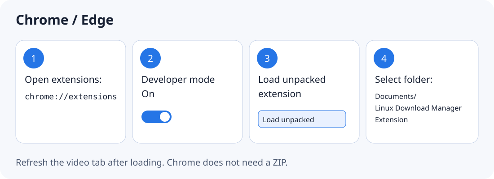
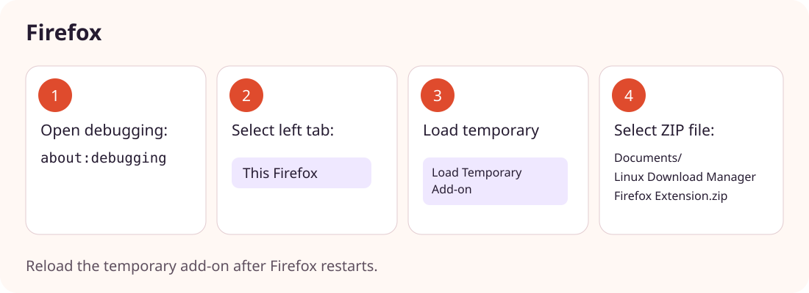

<p align="center">
  
</p>
<h1 align="center">Linux Download Manager</h1>
<p align="center">
  Download files, capture videos and manage your queue from one Linux desktop app.<br>
  Parallel transfers · Chrome & Firefox integration · Video and audio downloads
</p>
<p align="center">
  <a href="https://github.com/ekremx25/linux-download-manager/releases/latest"><strong>Download the latest release</strong></a> ·
  <a href="#install">Installation</a> ·
  <a href="#browser-extensions">Browser extensions</a> ·
  <a href="#troubleshooting">Help</a>
</p>

## Install

**Current release: v0.2.5 · Linux x86_64**

| Package | Download | How to launch |
| --- | --- | --- |
| Portable AppImage | [Linux_Download_Manager-0.2.5-x86_64.AppImage](https://github.com/ekremx25/linux-download-manager/releases/download/v0.2.5/Linux_Download_Manager-0.2.5-x86_64.AppImage) | Make executable, then open it. |
| Desktop installer | [LinuxDownloadManager-0.2.5-linux-x86_64.tar.gz](https://github.com/ekremx25/linux-download-manager/releases/download/v0.2.5/LinuxDownloadManager-0.2.5-linux-x86_64.tar.gz) | Extract, then run `Install.desktop` or `bash Install.sh`. |
| Checksums | [SHA256SUMS](https://github.com/ekremx25/linux-download-manager/releases/download/v0.2.5/SHA256SUMS) | Run `sha256sum --ignore-missing -c SHA256SUMS` beside your download. |

### AppImage

```bash
chmod +x Linux_Download_Manager-0.2.5-x86_64.AppImage
./Linux_Download_Manager-0.2.5-x86_64.AppImage
```

Keep the AppImage in a permanent location, such as `~/Applications`: browser integration and desktop autostart use its path. If FUSE is unavailable, launch with `--appimage-extract-and-run`.

Release packages are built on Ubuntu 22.04. The AppImage targets Ubuntu 22.04+ and compatible x86_64 Linux distributions; compatibility with every distribution is not guaranteed. The installer archive uses your system's GTK3 and WebKitGTK 4.1 libraries. If those are incompatible, build from source below.

**Video tools:** FFmpeg is needed for merging and conversion. Supported site extraction also uses yt-dlp and a JavaScript runtime. The AppImage does not install system packages; the source/archive installer can install dependencies with `pacman`, `apt` or `dnf`.

**Browser integration:** installing or launching LDM prepares the extension files. Complete the one-time browser steps below to activate them.

### Arch Linux / CachyOS package

An AUR-style source package is available in [`packaging/aur`](packaging/aur/README.md).
It uses pacman-managed dependencies and installs to `/usr`. See that guide for
local installation and publication status; a recipe in this repository alone
does not make the package available through `yay`.

### Build from source

```bash
git clone https://github.com/ekremx25/linux-download-manager.git
cd linux-download-manager
./install.sh
```

Run as your normal user. The installer requests `sudo` for system dependencies and installs LDM under `~/.local/bin`. Building requires Rust and GTK3/WebKitGTK 4.1 development libraries. Launch **Linux Download Manager** from your applications menu.

## See it in action


*Screenshots show example transfers. Colors follow your system theme; speeds depend on your network and the source server.*

## Unreleased fixes

- Cache supported separate HLS video and audio tracks before merging: video uses
  parallel transfers, while audio uses up to four workers and slows down on rate limits. Audio
  failures preserve cached fragments for retry. Unsupported manifests still use
  FFmpeg. Segment filenames no longer cause audio fragments to be discarded.
- Direct HLS transfers no longer run a separate yt-dlp download first. Progress
  reaches 100% only after the output is finalized. Previously downloaded silent
  files need to be downloaded again.

## What's new in v0.2.5

- **Recovery from unreachable CDN addresses.** If an HLS fragment connection fails, LDM can retry using an independent DNS answer instead of immediately abandoning parallel downloads.
- **Incomplete-video detection.** Where a finite playlist duration is available, LDM checks the resulting media duration and rejects significantly shortened output.
- **Better embedded-stream handling.** Verified HLS playlists are recognized even when the website uses an unusual URL or content type.
- **Duplicate capture protection.** Active Molystream captures for the same video and output settings share one download, including master/quality playlist variants.
- **Clearer progress.** Unknown totals no longer display a misleading full connection bar.

The DNS recovery uses Cloudflare DNS-over-HTTPS only after a connection error. It sends the fragment hostname, not the video URL or browser credentials; it leaves system DNS settings unchanged and retains HTTPS certificate validation. HTTP errors such as 403 and 429 do not trigger this DNS retry. Source-server rate limits still apply.

## Features

| Feature | What you can do |
| --- | --- |
| Parallel transfers | Choose Automatic or 1–16 connections per file; default: 10. Supported HLS streams can download fragments concurrently. |
| Browser integration | Capture file downloads and detected video streams from Chrome, Chromium, Edge, Brave, Vivaldi and Firefox. |
| Video and audio | Choose MP4, MKV, MOV or WebM, or extract MP3/M4A audio with FFmpeg. |
| Saved preferences | Remember your resolution limit, format, connections and speed limit. |
| Queue and scheduling | Add batches of up to 100 unique URLs and schedule downloads. |
| Download controls | Pause, resume, retry or cancel; use selection controls for multiple items. |
| File management | Search, sort and filter categories; remove history entries or delete downloaded files explicitly. |
| Integrity checks | Optionally verify a download against a SHA-256 checksum. |
| Desktop integration | System theme colors, tray operation, notifications and optional start at login. |
| Browser popup | Inspect desktop transfers and pause, resume or cancel them from the extension. |

Website support depends on stream detection, yt-dlp and access requirements. Some embedded players need to start playing before LDM can detect their stream. Resume and parallel transfer support depend on the source.

## Browser extensions

Install or launch the desktop app first. LDM prepares these files in your system Documents directory (usually `~/Documents`):

```text
Linux Download Manager Extension/             ← Chrome / Edge / Brave / Chromium
Linux Download Manager Firefox Extension/     ← Firefox source files
Linux Download Manager Firefox Extension.zip  ← Firefox temporary installation
```

### Chrome, Edge, Brave and Chromium



1. Open `chrome://extensions`, `edge://extensions` or `brave://extensions`.
2. Enable **Developer mode**, then click **Load unpacked**.
3. Select **`~/Documents/Linux Download Manager Extension`** — the folder itself.
4. Confirm **Linux Download Manager Bridge** appears. Pin it if desired, then refresh open video tabs.

**Chrome does not need a ZIP.** Keep the unpacked folder in place. After updating extension files, click **Reload** on its card and refresh the page.

### Firefox



1. Open `about:debugging`.
2. Choose **This Firefox** in the sidebar, not **Setup**.
3. Click **Load Temporary Add-on**.
4. Select **`~/Documents/Linux Download Manager Firefox Extension.zip`** and refresh your video page.

Firefox removes temporary add-ons when it restarts. Load the ZIP again afterward. Permanent installation in standard Firefox requires a Mozilla-signed add-on; the ZIP is a local testing package, not a signed store release.

[Open the detailed visual extension guide](docs/extension-install-en.md).

## Everyday use

### Files and videos

- **Direct files:** click **Add URL** and paste a file link. For a batch, use one URL per line.
- **Video:** play the video if needed, then click **Download video · LDM**. By default, this uses the best available video quality and the saved video container.
- **Quality and audio:** enable **Settings → Show video quality menu before downloading**, then click **Save**. The next video action lets you choose a resolution, format or audio-only download.
- **Details:** double-click a download to inspect it. Closing the details window does not stop the transfer.


*Enable the quality menu in Settings. Available results depend on the source; conversion may continue after the network transfer finishes.*

### Keep control of your files

| Action | Result |
| --- | --- |
| Pause | Stop transfer activity and retain partial data for supported resume. |
| Cancel download | Cancel the transfer. A later retry may need to restart. |
| Remove from list (keep file) | Remove the history entry without deleting the downloaded file. |
| Delete files and remove from list | Delete the associated files after confirmation. |
| Clear completed | Remove completed entries only; keep paused, failed and cancelled downloads. |

Files are categorized under `~/Downloads/LDM/` by default: Videos, Music, Images, Documents, Applications, Archives, ISO and Other. LDM respects `XDG_DOWNLOAD_DIR`; a custom save directory becomes the category base. **Show in folder** opens the exact location. Temporary fragments and partial files may use additional space while a transfer is underway.

### Preferences


Use Settings to choose speed limits, connection counts, captured file extensions and excluded sites. You can enable **Start LDM when I sign in** or **Open details when a download starts**. Save changes before closing Settings. Closing the main window hides it to the tray; use the tray menu to quit.

## Updates and removal

Download a newer AppImage or rerun the newer installer. Finish or pause active transfers before restarting. Keep the AppImage at a stable path, and reload the browser extension when its files change. Installation preserves download history and creates backups of replaced installation files.

For a clean source checkout with a tracking branch:

```bash
./install.sh --update
```

| Installer option | Purpose |
| --- | --- |
| `--check` | Inspect the installation plan. |
| `--no-deps` | Skip dependency installation and tool downloads. |
| `--skip-build` | Install existing local release binaries. |
| `--prebuilt` | Install binaries from an extracted installer archive. |

Run `./uninstall.sh` from the installer/source directory to remove an installed copy. Downloaded files, history and backups are preserved. Remove the browser extension separately.

## Troubleshooting

| Symptom | What to check |
| --- | --- |
| No video button | Reload the extension, refresh the page and start the video. |
| Stream not detected | Wait for the main video to play; refresh the page if the player changed. |
| Unknown size | Some streams do not publish a reliable total. Check received bytes and speed; an unknown total alone does not mean the transfer failed. |
| Slow or stalled HLS transfer | Update to v0.2.5 for connection-error DNS recovery. Check speed limits and source availability; adding connections cannot guarantee higher speed. |
| 429 Too Many Requests | The server is limiting requests. Wait and avoid simultaneous downloads from that source. |
| Incomplete video error | Some fragments were unreachable. Capture a fresh stream and retry; LDM will not mark the shortened output as complete. |
| Unsupported URL | The captured link may be a player page rather than its media stream. Reload the extension and play the video before capturing again. |
| 100% but still processing | FFmpeg may be merging streams or converting media. |
| Firefox service_worker error | Load the Firefox ZIP, not the Chromium manifest. |
| Changes do not appear | Fully quit and restart LDM; reload the extension and refresh open tabs. |
| Missing libraries | Install the runtime dependencies or build from source on your distribution. |

For capture troubleshooting, right-click the extension icon and choose **Export capture diagnostics**. Include the LDM version, browser, error message and whether the video plays in the browser when reporting a problem. Avoid posting private credentials or authenticated media URLs publicly.

## Development

Rust + Tauri 2 + SQLite + reqwest, with a plain HTML/CSS/JavaScript interface. Media workflows use yt-dlp and FFmpeg.

```bash
cargo build --release --locked --bins
cargo test --locked --workspace
node scripts/test-extension-settings.cjs
node scripts/test-embedded-player.cjs
python3 scripts/test-installer.py

# Create a local installer archive in dist/
./scripts/build-installer.sh
```

The GitHub Actions **Build Linux packages** workflow builds the AppImage and installer on Ubuntu 22.04, checks their payloads and uploads checksummed artifacts. Additional tests in `scripts/` cover browser capture and transfer behavior; browser tests may require Playwright, Chromium and a local UI server.

| Directory | Contents |
| --- | --- |
| `src-tauri/src/` | Desktop application, transfer engine, persistence and native bridge |
| `ui/` | Download library, settings and detail windows |
| `browser/chromium/` | Shared extension implementation and Chromium manifest |
| `browser/firefox/` | Firefox manifest |
| `scripts/` | Packaging and regression checks |
| `docs/` | Visual installation instructions and screenshots |

Built with [Tauri](https://tauri.app/), [yt-dlp](https://github.com/yt-dlp/yt-dlp) and [FFmpeg](https://ffmpeg.org/).

## License

MIT — see [LICENSE](LICENSE).
