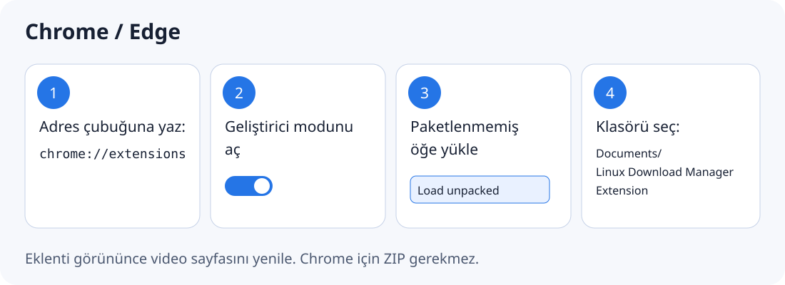
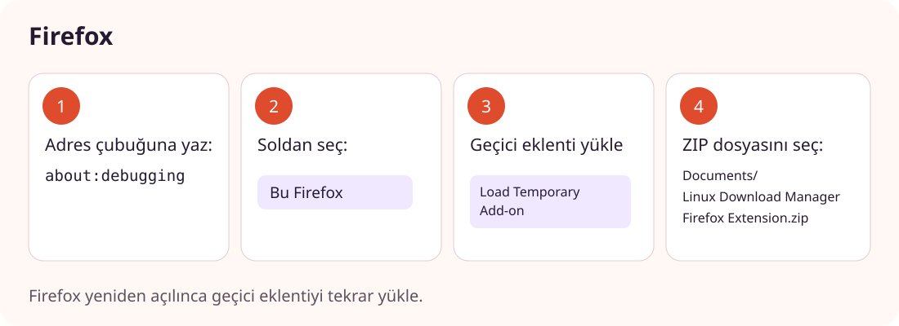

# LDM tarayıcı eklentisini kurma

Önce Linux Download Manager uygulamasını kurun. Kurulum, eklenti dosyalarını ve tarayıcı ile uygulama arasındaki bağlantıyı hazırlar. Sonra kullandığınız tarayıcı için aşağıdaki adımları uygulayın.

## Google Chrome, Chromium, Brave veya Edge

1. Chrome adres çubuğuna `chrome://extensions` yazıp **Enter** tuşuna basın. Edge kullanıyorsanız `edge://extensions` açın. Brave için `brave://extensions` kullanabilirsiniz.
2. Sayfanın sağ üstündeki **Geliştirici modu / Developer mode** anahtarını açın.
3. Görünen **Paketlenmemiş öğe yükle / Load unpacked** düğmesine basın.
4. Dosya seçicisinde **`/home/ekrem/Documents/Linux Download Manager Extension`** klasörünü seçin. Başka bir kullanıcı hesabında yol `~/Documents/Linux Download Manager Extension` olur. Klasörün içindeki `manifest.json` dosyasını tek başına seçmeyin; klasörün kendisini seçin.
5. Eklenti kartında **Linux Download Manager Bridge** göründüğünü kontrol edin. İsterseniz araç çubuğundaki yapboz simgesinden eklentiyi sabitleyin. Açık video sekmelerini yenileyin.

Chrome için ZIP dosyası gerekmez. Eklenti bu klasörden çalıştığı için klasörü taşımayın veya silmeyin. LDM güncellendiğinde eklenti kartındaki **Yeniden yükle / Reload** düğmesine basın ve video sayfasını yenileyin.

## Firefox

1. Firefox adres çubuğuna `about:debugging` yazıp **Enter** tuşuna basın.
2. Solda **Bu Firefox / This Firefox** bölümünü açın. **Setup / Kurulum** ekranında kalmayın.
3. **Geçici eklenti yükle / Load Temporary Add-on** düğmesine basın.
4. **`/home/ekrem/Documents/Linux Download Manager Firefox Extension.zip`** dosyasını seçin. Başka bir kullanıcı hesabında yol `~/Documents/Linux Download Manager Firefox Extension.zip` olur.
5. Eklentinin **Geçici Eklentiler / Temporary Extensions** altında göründüğünü kontrol edin ve video sayfasını yenileyin.

Bu yöntem Firefox'ta **geçicidir**: Firefox kapanıp yeniden açılınca eklentiyi aynı ZIP'ten yeniden yüklemeniz gerekir. Kalıcı kurulum için Mozilla tarafından imzalanmış bir eklenti gerekir. ZIP dosyasını açmanız veya içinden `manifest.json` seçmeniz gerekmez.

Eklenti görünse bile indirme başlamıyorsa önce LDM masaüstü uygulamasını açın. Güncellemeden sonra eklentiyi yeniden yükleyin ve açık video sekmelerini yenileyin.
